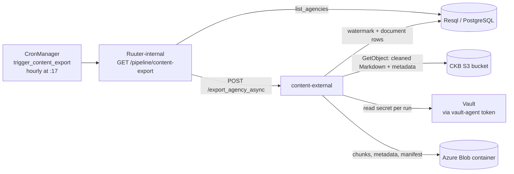

# Content-external in staging — deployment guide

Every step and setting needed to run the content-external pipeline in staging
with the **object-store sink on Azure Blob**, for both Docker Compose and Helm.
Operating detail lives in [RUNBOOK.md](../RUNBOOK.md) and design detail in
[README.md](../README.md); this guide links to them rather than repeating them.

Written 2026-11-04, against branch `feat/content-external-pipeline` and
upstream `v2.0.0`. The Helm path was run end to end in minikube that day,
with Azurite standing in for Azure and a dev-mode Vault: Steps 2, 4B, 5, 6
and the scheduled export in Step 7 all behaved as written. Not verifiable
there: deletes on real Azure (Step 7.4), service-principal login, and network
access to a real storage account.

## Contents

- [Overview](#overview)
- [Decisions to make first](#decisions-to-make-first)
- [Blockers to clear before staging](#blockers-to-clear-before-staging)
- [Step 1 — Azure: storage account, container, credential](#step-1--azure-storage-account-container-credential)
- [Step 2 — Vault: the Azure secret and the agent's access](#step-2--vault-the-azure-secret-and-the-agents-access)
- [Step 3 — Read access to CKB's own bucket](#step-3--read-access-to-ckbs-own-bucket)
- [Step 4A — Compose: configure and deploy](#step-4a--compose-configure-and-deploy)
- [Step 4B — Helm: configure and deploy](#step-4b--helm-configure-and-deploy)
- [Step 5 — Verify the deployment](#step-5--verify-the-deployment)
- [Step 6 — First run (bootstrap)](#step-6--first-run-bootstrap)
- [Step 7 — Enable the schedule](#step-7--enable-the-schedule)
- [Step 8 — Day-2 operation and troubleshooting](#step-8--day-2-operation-and-troubleshooting)
- [Configuration reference](#configuration-reference)
- [Appendix — the llm-module sink instead](#appendix--the-llm-module-sink-instead)
- [Checklist](#checklist)

## Overview

In staging, content-external copies every finished CKB document into an Azure
Blob container as chunked JSON, once an hour. It never writes to CKB: it reads
document rows through Resql and the cleaned Markdown from CKB's own S3 bucket,
then writes chunks, per-document metadata and a manifest to Azure.



- **Trigger:** CronManager runs `trigger_content_export` at minute 17 of every
  hour, once enabled ([Step 7](#step-7--enable-the-schedule)). It calls
  Ruuter-internal `GET /pipeline/content-export`, which finds the agency and
  calls content-external `POST /export_agency_async`.
- **Unchanged hours are cheap:** each run first compares the agency's latest
  `updated_at` and live document count with the last run. If nothing changed
  it stops with `unchanged` in about 2 s.
- **What lands in Azure:** `content/agencies/<agency_id>/manifest.json`, plus
  `documents/<document_id>/metadata.json` and `chunks/NNNNN.json` per
  document. The manifest lives in the same container, so an empty container
  means a first run.
- **Only finished documents are published.** Rows still scraping, cleaning or
  `in_review` are held back; deleted, excluded and `not_found` rows are removed
  from the destination.
- **Credentials:** the Azure credential is read from Vault on every run, so
  nothing secret sits in `.env` or a values file.

For scale: in local testing, 100 cleaned documents produced about 1,600
objects (about 2 MB), and a first export of 100 took 15–20 s against a fast
store.

## Decisions to make first

Agree these four before touching any configuration; every later step depends
on them.

| Decision | Options | Recommended for staging |
| --- | --- | --- |
| Deployment method | Docker Compose (`docker-compose.yml` + root `.env`) or Helm (`charts/ckb/values.yaml` + `--set` flags in the deploy job) | Whatever staging already runs CKB on. [Step 4A](#step-4a--compose-configure-and-deploy) and [Step 4B](#step-4b--helm-configure-and-deploy) cover each |
| Content sink | `object_store` (files in a bucket or container) or `llm_module` (pushed to the LLM module's API) | `object_store` on Azure Blob. The `llm_module` contract is not signed off yet ([appendix](#appendix--the-llm-module-sink-instead)) |
| Azure credential form | Account key, SAS token, or a service principal (`tenant_id` + `client_id` + `client_secret`) | Service principal with *Storage Blob Data Contributor* on the one container: scoped, and revocable without rotating the account key |
| Chunk profile | A preset in `content-external/exporter/core/constants.py` `CHUNK_PROFILES` | `azure_native`, the current default. Changing it later re-chunks the whole corpus |

Use a **new, empty** Azure container dedicated to this pipeline. The service
refuses a container that already holds objects but no manifest
(`NonEmptyDestination`).

## Blockers to clear before staging

A Helm deployment cannot work today without the fixes below; a Compose
deployment needs only rows 1, 2 and 4. Rows 5–9 were found by installing the
chart in minikube on 2026-11-04.

| # | Blocker | Affects | Fix |
| --- | --- | --- | --- |
| 1 | Branch changes not merged. The content-external code, DSL and chart are on `v2.0.0`; the Azure switches in `docker-compose.yml` and in the chart (`contentExternal.storeBackend`, `extraEnv`, the always-rendered `serviceAccountName`), and the image-tag fix, are only on `feat/content-external-pipeline` | Both | Merge them into the branch staging deploys from |
| 2 | The database lacks the export index (changelog `20261020120000-add-source-file-export-index`) | Both | Run Liquibase from `v2.0.0`; [Step 5](#step-5--verify-the-deployment) checks it |
| 3 | No content-external image on GHCR. `build-content-external.yml` builds only on a push to `wip`, which exists only on the `rootcodelabs` fork | Helm | Run the workflow in the `buerokratt` repo so `ghcr.io/buerokratt/common-knowledge:content-external-dev-1-1-1` exists |
| 4 | CronManager, Ruuter-internal and Resql must carry the content-export DSL: `DSL/CronManagerScripts/trigger_content_*.sh`, `DSL/Ruuter.internal/ckb/GET/pipeline/content-*.yml`, `DSL/Resql/ckb/GET/agency/get_agency_export_watermark.sql` and `DSL/Resql/ckb/GET/source_file/list_agency_export_documents.sql` | Both | Compose mounts them from the checkout. Helm: row 5 |
| 5 | The chart's init containers run `git clone --branch dev`; upstream `dev` has none of the content-export DSL | Helm | Clone `v2.0.0` (or merge `v2.0.0` into `dev`) in the Ruuter, Ruuter-internal, Resql, DataMapper and CronManager templates |
| 6 | Ruuter never loads `constants.ini`: the chart mounts it at `/app/config/constants.ini`, Ruuter reads `/app/constants.ini`. Every `[#CKB_RESQL]` placeholder stays unresolved (`Failed to resolve '%5B'`) | Helm | Change the `mountPath` in `ruuter-deployment.yaml` and `ruuter-internal-deployment.yaml` to `/app/constants.ini` |
| 7 | Resql connects to `database:5432`; the chart's database Service is `<release>-database` | Helm | Set `SQLMS_DATASOURCES_0_JDBCURL` to `jdbc:postgresql://<release>-database:5432/ckb_db` |
| 8 | The Liquibase job uses `liquibase/liquibase:latest` (5.x, no PostgreSQL driver) and the `varmoh` fork's 2025 `dev` (14 changelogs missing) | Helm | `liquibase.image.tag: "4.33"`, `liquibase.repo: https://github.com/buerokratt/Common-Knowledge.git`, `liquibase.branch: v2.0.0` |
| 9 | Ruuter has no readiness probe, so Kubernetes reports it available about 10 s before it listens | Helm | Add a readiness probe, or expect the first cron tick after a Ruuter restart to fail |

Rows 5–9 affect all of CKB on Helm, not only this pipeline. Running `helm`
from a Windows checkout also breaks `charts/ckb/constants.ini`, a symlink
checked out as a text file; deploy from Linux or CI.

## Step 1 — Azure: storage account, container, credential

Create the container yourself before the first run; the service never creates
one.

1. **Storage account.** Use an existing account or create one in the public
   Azure cloud. The service-principal path is fixed to the public cloud
   authority, so Azure Government and Azure China are not supported.
2. **Container.** Create a new, private container, for example
   `ckb-content-external-staging`. Its exact name becomes
   `AZURE_STORAGE_CONTAINER`.

   ```bash
   az storage container create --account-name <account> \
     --name ckb-content-external-staging --auth-mode login
   ```

3. **Credential.** Create exactly one of these. The service uploads,
   downloads, lists, reads properties of and deletes blobs (deletes in batches
   of up to 256 through the Blob Batch API).
   - **Service principal (recommended):** an app registration with a client
     secret, granted *Storage Blob Data Contributor* scoped to the container:

     ```bash
     az role assignment create --role "Storage Blob Data Contributor" \
       --assignee <client_id> \
       --scope /subscriptions/<sub>/resourceGroups/<rg>/providers/Microsoft.Storage/storageAccounts/<account>/blobServices/default/containers/ckb-content-external-staging
     ```

   - **SAS token:** read, add, create, write, delete and list on the
     container, with an expiry you will rotate before it lapses.
   - **Account key:** works, but grants the whole account; avoid it outside
     short-lived testing.
4. **Network.** The host or cluster running content-external must reach
   `https://<account>.blob.core.windows.net` on port 443. If the account has a
   firewall, allow the staging egress IPs or use a private endpoint.

Keep the account URL and the credential for Step 2. Only the container name
goes into `.env` or a values file.

## Step 2 — Vault: the Azure secret and the agent's access

The Azure credential lives only in Vault, at the KV v2 path
`secret/blob/connections/azure_blob/content`. Every run reads it through a
token that a Vault Agent keeps fresh, so a rotated credential is used at the
next run with no restart.

### 2.1 Write the secret

It must hold `account_url` plus exactly one credential form, and no keys from
another form:

| Form | Keys |
| --- | --- |
| Service principal | `account_url`, `tenant_id`, `client_id`, `client_secret` |
| SAS token | `account_url`, `sas_token` |
| Account key | `account_url`, `account_key` |

`account_url` is `https://<account>.blob.core.windows.net` with no query
string; a SAS goes in `sas_token`, never on the URL.

```bash
# Compose: the root token is in unseal-keys.json on the vault-init-data volume
docker compose exec -e VAULT_TOKEN=<token> vault \
  vault kv put secret/blob/connections/azure_blob/content \
    account_url=https://<account>.blob.core.windows.net \
    tenant_id=<tenant> client_id=<client> client_secret=<secret>
```

Use `kv put`, **not** `kv patch`. `vault/init.sh` seeds the path with
`account_url` and `account_key` set to `REPLACE_ME`; a patch would keep that
placeholder `account_key` beside your new form, and every run would be refused
for holding two forms.

### 2.2 Policy

`content-external-policy` grants read on that path. On Compose,
[`vault/init.sh`](../../vault/init.sh) creates it on every `vault-init` run. On
Helm, if the cluster uses a different Vault, create it there with the same
rules (`vault/init.sh` lines 221–228):

```hcl
path "secret/data/content-external/*" { capabilities = ["read"] }
path "secret/data/blob/connections/azure_blob/content" { capabilities = ["read"] }
path "secret/metadata/blob/connections/azure_blob/content" { capabilities = ["read"] }
path "secret/data/encryption/*" { capabilities = ["deny"] }
path "secret/data/llm/*" { capabilities = ["deny"] }
path "auth/token/renew-self" { capabilities = ["update"] }
path "auth/token/lookup-self" { capabilities = ["read"] }
```

Upload it from a file with `vault policy write content-external-policy policy.hcl`.
Piping it through PowerShell adds a byte-order mark, which Vault rejects as
`illegal char` at 1:1.

### 2.3 Agent authentication

- **Compose (AppRole):** `vault-init` writes `content_role_id` and
  `content_secret_id` to the `vault-agent-creds` volume, and
  `vault-agent-content` logs in with them. The `secret_id` expires 24 h after
  it is minted and is renewed only when `vault-init` runs again. **Re-run it
  at least daily**, for example from host cron:

  ```bash
  docker compose up --force-recreate --no-deps vault-init
  ```

  Otherwise, about a day after deployment, every Azure run fails with
  `error_type: ConfigurationError` (Vault answers 403 to the expired token).
- **Helm (Kubernetes auth, recommended):** once per cluster, bind the policy
  to the chart's service account (`content-external` when
  `serviceAccount.create: true`):

  ```bash
  vault auth enable kubernetes
  vault write auth/kubernetes/config \
    kubernetes_host="https://$KUBERNETES_SERVICE_HOST:$KUBERNETES_SERVICE_PORT"
  vault write auth/kubernetes/role/content-external-service \
    bound_service_account_names=content-external \
    bound_service_account_namespaces=<namespace> \
    token_policies=content-external-policy token_ttl=1h token_max_ttl=4h
  ```

  Kubernetes auth needs no rotation. The chart also supports AppRole
  (`vaultAgent.auth.method: approle` plus a Secret holding `role_id` and
  `secret_id`), but then something must rotate that Secret daily.

## Step 3 — Read access to CKB's own bucket

Content-external reads the cleaned Markdown and its metadata sidecar from
CKB's S3 bucket, the one file-processing writes. It only ever calls
`s3:GetObject`, so give it a key with exactly that on the bucket (plus
`kms:Decrypt` if the bucket uses SSE-KMS):

```json
{
  "Version": "2012-10-17",
  "Statement": [{
    "Effect": "Allow",
    "Action": "s3:GetObject",
    "Resource": "arn:aws:s3:::<ckb-bucket>/*"
  }]
}
```

- **Helm:** create a dedicated read-only key and put it in its own Secret
  ([Step 4B](#step-4b--helm-configure-and-deploy)). The chart keeps it separate
  from file-processing's keys.
- **Compose:** content-external and file-processing both read
  `AWS_ACCESS_KEY_ID` and `AWS_SECRET_ACCESS_KEY` from the same root `.env`, so
  content-external runs with file-processing's read-write key. It works, but it
  is broader than needed. Separating them needs a `docker-compose.yml` change
  (distinct variable names for content-external); raise it with the team if
  staging policy requires least privilege.

This key only reads CKB's bucket. It is never the Azure credential, which
comes from Vault (Step 2).

## Step 4A — Compose: configure and deploy

On Compose, everything staging-specific goes in the root `.env` on the staging
host; `docker-compose.yml` defaults to S3 and switches to Azure when `.env`
says so. This needs blocker 1 merged.

1. **Update the checkout** to the branch carrying the content-external code
   and DSL.
2. **Add to the root `.env`:**

   ```bash
   # content-external on Azure Blob
   CONTENT_EXTERNAL_STORE_BACKEND=azure_blob
   AZURE_STORAGE_CONTAINER=ckb-content-external-staging
   COMPOSE_PROFILES=azure-blob          # starts vault-agent-content

   # CKB's own bucket (already present for file-processing)
   S3_ENDPOINT_URL=https://<ckb-s3-endpoint>
   S3_BUCKET_NAME=<ckb-bucket>
   AWS_ACCESS_KEY_ID=<key>
   AWS_SECRET_ACCESS_KEY=<secret>
   AWS_REGION=<region>
   ```

   Leave `EXTERNAL_S3_*` unset: they configure the S3 destination and are not
   read on Azure. `CONTENT_SINK=object_store`, `CHUNK_PROFILE=azure_native`,
   `CONTENT_WORK_DIR`, `VAULT_TOKEN_PATH` and `VAULT_SECRET_PATH` are fixed in
   `docker-compose.yml`.
3. **Apply the migrations** from the same checkout. `migrate.sh` runs the
   unpinned `liquibase/liquibase` image, which is now 5.x and ships without
   the PostgreSQL driver: change that image to `liquibase/liquibase:4.33`
   first, then run `./migrate.sh` (Git Bash or WSL on Windows).
4. **Start or rebuild.** Content-external is built from the checkout, so no
   registry image is needed:

   ```bash
   docker compose up -d --build content-external
   docker compose up -d vault-init vault-agent-content
   docker compose restart ruuter-internal resql-ckb cron-manager   # pick up the new DSL
   ```

5. **Schedule the AppRole renewal** from [Step 2.3](#23-agent-authentication)
   (a daily `vault-init` re-run).

Optional switches are **not** read from `.env`. `DRAIN_DELETES_ENABLED`,
`RECONCILE_REPAIR_ENABLED` and `STALE_SWEEP_ENABLED` sit commented out in the
`content-external` service of `docker-compose.yml`; turning one on means
uncommenting it. Any other setting from the
[configuration reference](#configuration-reference), such as
`EXPORT_CONCURRENCY` or `DIFF_ON_MISSING_MANIFEST`, is added there as a new
`environment` line.

## Step 4B — Helm: configure and deploy

On Helm there is one values file, [`charts/ckb/values.yaml`](../../charts/ckb/values.yaml),
and it defaults to S3. Staging switches to Azure with `--set` flags in its
deploy job (or the equivalent parameters in its CD tool). Secrets go in
Kubernetes Secrets and Vault, never in values. Clear blockers 3 and 5–9 first.

The Azure switch is a set of plain scalar values, so `--set` is safe:

| Value | Staging setting | What it does |
| --- | --- | --- |
| `contentExternal.storeBackend` | `azure_blob` | Renders `CONTENT_EXTERNAL_STORE_BACKEND`; default `s3` |
| `contentExternal.azure.container` | your container | Renders `AZURE_STORAGE_CONTAINER` |
| `contentExternal.azure.vaultSecretPath` | leave the default | Renders `VAULT_SECRET_PATH` (`blob/connections/azure_blob/content`) |
| `contentExternal.vaultAgent.enabled` | `true` | Runs the Vault Agent sidecar; sets `VAULT_ADDR` and `VAULT_TOKEN_PATH` |
| `contentExternal.vaultAgent.vaultAddr` | your Vault URL | Default `http://vault:8200` |
| `contentExternal.serviceAccount.create` | `true` | Creates the `content-external` service account that Step 2.3 binds |
| `contentExternal.sourceBucket.*` | CKB's bucket | Endpoint, bucket, region and the Secret holding the read key |
| `contentExternal.extraEnv` | as needed | Extra settings appended to `env`, such as `DIFF_ON_MISSING_MANIFEST` |

The chart refuses to render `azure_blob` without a container, without a Vault
agent, or with any of the rendered names also set in `env` or `extraEnv`, so
a mistake fails the deploy rather than the first run.

1. **Create the source-bucket Secret** (the read-only key from Step 3):

   ```bash
   kubectl -n <namespace> create secret generic ckb-source-readonly \
     --from-literal=access_key_id=<key> \
     --from-literal=secret_access_key=<secret>
   ```

2. **Put the staging flags in the deploy job:**

   ```bash
   helm upgrade --install ckb charts/ckb -n <namespace> \
     --set contentExternal.storeBackend=azure_blob \
     --set contentExternal.azure.container=ckb-content-external-staging \
     --set contentExternal.vaultAgent.enabled=true \
     --set contentExternal.vaultAgent.vaultAddr=https://<staging-vault>:8200 \
     --set contentExternal.serviceAccount.create=true \
     --set contentExternal.sourceBucket.endpointUrl=https://<ckb-s3-endpoint> \
     --set contentExternal.sourceBucket.bucket=<ckb-bucket> \
     --set contentExternal.sourceBucket.region=<region> \
     --set contentExternal.sourceBucket.secret.name=ckb-source-readonly
   ```

   - Never `--set` an item of `contentExternal.env`: Helm replaces the whole
     list, silently dropping `CONTENT_SINK` and `CHUNK_PROFILE`. Use
     `extraEnv`, which is empty by default:
     `--set-json 'contentExternal.extraEnv=[{"name":"DIFF_ON_MISSING_MANIFEST","value":"fail"}]'`.
     A later `--set-json` of `extraEnv` replaces the earlier one, so pass every
     entry each time.
   - Do not set `VAULT_ADDR`, `VAULT_TOKEN_PATH`,
     `CONTENT_EXTERNAL_STORE_BACKEND`, `AZURE_STORAGE_CONTAINER` or
     `VAULT_SECRET_PATH` in `env` or `extraEnv`; the chart renders them and
     refuses duplicates.
   - Leave `externalStore` empty; it is the S3 destination and is not read on
     Azure.
3. **Check storage.** The work PVC (`content-external-work-pvc`, 1 Gi) uses
   the cluster's default StorageClass and must be `ReadWriteOnce` on block or
   local storage, never NFS, EFS or CephFS: the run lock is an `flock`. The
   chart refuses any other access mode.
4. **Check resources.** The default limit is 1 Gi of memory, which fits the
   default `EXPORT_CONCURRENCY=4`. The service refuses to start if
   concurrency × `MAX_DOCUMENT_BYTES` × 3 + about 192 Mi exceeds the limit, so
   raise both together.
5. **Check the image.** `contentExternal.image.tag` is
   `content-external-dev-1-1-1`; it must exist on
   `ghcr.io/buerokratt/common-knowledge` (blocker 3).
6. **Deploy** with the command from item 2, from a Linux machine or CI.

The deployment runs one replica with the `Recreate` strategy by design. Never
scale it: two pods would run two exports at once.

## Step 5 — Verify the deployment

Run these before any export. `/health` confirms the configuration, not access
to Azure; the first sample run in Step 6 proves that.

1. **Health.** It must show the Azure backend. The image has no `curl`, so
   use Python:

   ```bash
   # Compose
   docker compose exec content-external python -c \
     "import urllib.request as u; print(u.urlopen('http://localhost:8125/health').read().decode())"
   # Helm
   kubectl -n <namespace> exec deploy/content-external -c content-external -- python -c \
     "import urllib.request as u; print(u.urlopen('http://localhost:8125/health').read().decode())"
   ```

   Expect `"status": "ok"`, `"sink": "object_store"`,
   `"store_backend": "azure_blob"`, `"chunk_profile": "azure_native"`,
   `"work_dir": "/var/lib/content-external"`. `last_run` is `null` on a fresh
   install; it lives on the work volume, so a redeploy keeps the previous run.
2. **Startup log.** The `content-external config` line echoes every setting
   with secrets masked. Check `content_external_store_backend=azure_blob`,
   `azure_storage_container=<your container>` (`[unset]` means it is empty),
   `vault_secret_path=blob/connections/azure_blob/content`, and the
   `memory budget … within container limit` line that follows it. An
   `agency_guard` warning at startup is normal if Resql was still starting.
3. **Vault token.** The agent must have written a non-empty token:

   ```bash
   # Compose
   docker compose exec content-external sh -c 'test -s /agent/out/token && echo token ok'
   # Helm (tokenMountPath defaults to /vault/agent)
   kubectl -n <namespace> exec deploy/content-external -c content-external -- \
     sh -c 'test -s /vault/agent/token && echo token ok'
   ```

4. **Export index.** It must exist (blocker 2):

   ```sql
   SELECT indexname FROM pg_indexes
   WHERE schemaname = 'data_collection' AND tablename = 'source_file'
     AND indexname = 'idx_source_file_agency_base_updated';
   ```

5. **Cron job registered.** CronManager's log lists `trigger_content_export`
   with trigger `false` (registered, not scheduled), and the three
   `trigger_content_*.sh` scripts are present under `/app/scripts`.
6. **Agency id.** Note the agency's `base_id` for Step 6 (one agency per
   deployment):

   ```sql
   SELECT DISTINCT base_id, name FROM agency_management.agency;
   ```

## Step 6 — First run (bootstrap)

The first export publishes the whole corpus into the empty container. Do it
by hand, with the schedule still off. This follows
[RUNBOOK.md — First deployment (bootstrap)](../RUNBOOK.md#first-deployment-bootstrap).

Run the CLI inside the content-external container, which has the configured
environment: prefix each command with `docker compose exec content-external`
(Compose) or `kubectl -n <namespace> exec deploy/content-external -c content-external --`
(Helm).

1. **Keep the schedule off:** `trigger_content_export` stays
   `trigger: "false"` in `DSL/CronManager/scheduler.yml`.
2. **Sample of 25** proves CKB access, Vault and Azure end to end:

   ```bash
   python -m exporter.run_sync --agency-id <agency_base_id> --limit 25 --output-json -
   ```

   Expect `outcome: success`, `first_run_probe: empty`, `new_count` up to 25
   and `publish_failed_count: 0`. Then look in the container: a
   `manifest.json`, and per document a `metadata.json` and `chunks/`:

   ```bash
   az storage blob list --account-name <account> --auth-mode login \
     --container-name ckb-content-external-staging \
     --prefix content/agencies/<agency_base_id>/ --query "[].name" -o tsv | head
   ```

   A run refused before the export starts (a bad Vault secret, a missing
   setting) prints no report. Its reason is in the `content-external error`
   log line and in `/health`'s `last_run.error_type`.

3. **Full export,** keeping the report:

   ```bash
   python -m exporter.run_sync --agency-id <agency_base_id> \
     --output-json /var/lib/content-external/bootstrap-report.json
   ```

   It continues from the sample's manifest. Large corpora checkpoint every
   250 documents (`BOOTSTRAP_CHECKPOINT_EVERY`), so an interrupted run resumes.
4. **Read the report:** `outcome`, `new_count`, `skipped_count` with
   `skipped_reasons`, `dead_lettered_count`, `publish_failed_count` and
   `duration_seconds`. Resolve failures before going on. A large skipped count
   on a fresh CKB is expected: documents still scraping, cleaning or
   `in_review` are held back, and uploaded files are always skipped as
   `uploaded_file_uncitable`.
5. **Spot-check** a few document ids from the report against the container:
   each has a `metadata.json` and as many chunks as the manifest records.
6. **Lock in the manifest:** set `DIFF_ON_MISSING_MANIFEST=fail` and
   redeploy. On Compose, add it as a new `environment` line of the
   `content-external` service. On Helm, add it to the deploy job's
   `--set-json 'contentExternal.extraEnv=[{"name":"DIFF_ON_MISSING_MANIFEST","value":"fail"}]'`.
   From now on, a missing manifest fails the run instead of silently starting
   a second first run.

## Step 7 — Enable the schedule

Schedules live in [`DSL/CronManager/scheduler.yml`](../../DSL/CronManager/scheduler.yml).
All three content jobs ship as `trigger: "false"`. Enable them in this order,
keeping the value quoted:

| Order | Job | Set `trigger:` to | When |
| --- | --- | --- | --- |
| 1 | `trigger_content_export` | `"0 17 */1 * * ?"` (hourly at :17) | After Step 6 succeeds |
| 2 | `trigger_content_drain` | `"0 47 */1 * * ?"` (hourly at :47) | Any time; it only reports while `DRAIN_DELETES_ENABLED` is off |
| 3 | `trigger_content_reconcile` | `"0 35 3 * * ?"` (daily at 03:35) | Any time; it only reports while `RECONCILE_REPAIR_ENABLED` is off |

How the change reaches CronManager:

- **Compose:** edit the file in the checkout, then
  `docker compose restart cron-manager`.
- **Helm:** CronManager clones `scheduler.yml` from git when its pod starts
  (blocker 5), so commit the change to the branch it clones, then
  `kubectl -n <namespace> rollout restart deploy/cron-manager`.

Then switch on the destructive halves, each after a dry cycle:

1. **Drain deletes** (retries deletes the destination refused). Run one full
   cycle dry, read the candidates against CKB (each should really be deleted,
   excluded or `not_found`), then set `DRAIN_DELETES_ENABLED=true`:

   ```bash
   python -m exporter.run_ops drain --agency-id <agency_base_id> --dry-run
   ```

2. **Reconcile repair** (removes orphaned tail chunks). Let one daily
   reconcile report, then set `RECONCILE_REPAIR_ENABLED=true`.
3. **Leave `STALE_SWEEP_ENABLED` off:** the object-store sink reports
   `not_supported`.
4. **Verify the first real delete.** Azure deletes go through the Blob Batch
   API, which could not be verified before staging: the Azurite emulator
   rejects batch requests with an account key and a SAS alike, while
   single-blob deletes work. After the first exclusion or removal in CKB,
   check that the run logged no `document deletes unresolved` warning and
   that a drain reports `still_unresolved=0`. If deletes stay unresolved,
   check the credential's delete permission and that nothing between the
   service and the account (a proxy or firewall) blocks `comp=batch`
   requests. Unlike S3, Azure has no setting to fall back to one-by-one
   deletes, so a persistent refusal needs a code change. A refused delete is
   never lost: it waits in the drain journal.

Where each flag goes: on Compose, uncomment its line in the
`content-external` service of `docker-compose.yml`. On Helm, add it to the
same `extraEnv` list as `DIFF_ON_MISSING_MANIFEST`, keeping the earlier
entries, since each `--set-json` replaces the list:

```bash
--set-json 'contentExternal.extraEnv=[{"name":"DIFF_ON_MISSING_MANIFEST","value":"fail"},{"name":"DRAIN_DELETES_ENABLED","value":"true"},{"name":"RECONCILE_REPAIR_ENABLED","value":"true"}]'
```

To trigger any job by hand, including while it is disabled:

```bash
curl -fsS -X POST '<cron-manager>/execute/scheduler/trigger_content_export'
```

Some CronManager versions answer a repeated `POST /execute` with 500
(`ClassCastException`) although the job ran: check `/health`'s `last_run`
instead of curl's exit code.

## Step 8 — Day-2 operation and troubleshooting

Read `last_run.outcome` on `/health`, not its status code: `/health` stays 200
after a failed run on purpose. Each run also logs one
`content-external run …` line with every count, and a failure before the
export adds a `content-external error` line with the sanitised cause.

**Alerts to agree with ops** (from [README.md](../README.md#the-alert-thresholds-to-agree-with-ops)):

| Signal | Threshold |
| --- | --- |
| `last_run.consecutive_failures` | ≥ 2 (one failure is the design retrying) |
| Time since the last `success` or `unchanged` | > 6 hours |
| `last_run.consecutive_busy` rising | Runs exceed the hourly interval: lengthen the interval |

**Troubleshooting:**

| Symptom | Cause | Fix |
| --- | --- | --- |
| `failed`, `error_type: ConfigurationError` | The Vault secret still holds `REPLACE_ME`, has two credential forms, has a query string on `account_url`, Vault answered 403/404, or the agent token file is missing or expired | Fix the secret ([2.1](#21-write-the-secret)), the policy ([2.2](#22-policy)) or the agent's login ([2.3](#23-agent-authentication)) |
| `failed`, `error_type: StoreError` | Vault unreachable or 5xx (retryable), or Azure refused or the container does not exist | Retryable: nothing, the next tick retries. Otherwise check the container name, the credential's role and the network path |
| `failed` naming `AZURE_STORAGE_CONTAINER` or `VAULT_SECRET_PATH` | The setting is empty | Set it ([4A](#step-4a--compose-configure-and-deploy) / [4B](#step-4b--helm-configure-and-deploy)) |
| First run fails with `NonEmptyDestination` | The container already holds objects but no manifest | Use an empty container |
| Cron job runs but nothing reaches content-external | Ruuter-internal lacks the DSL or `constants.ini` (blockers 4–6), or Ruuter was still starting (blocker 9) | Check Ruuter-internal's log for `pipeline/content-export` and `Failed to resolve` |
| Every tick `busy` | A run, drain or reconcile holds the lock past the next tick | Read `duration_seconds`; lengthen the interval |
| `document deletes unresolved; journalled for the drain`, and deleted documents still in the container | Azure refused the batch delete. The run still commits; the deletes wait in the journal | Check the credential can delete, and that Blob Batch requests reach the account. The drain retries every hour; `reconcile` shows the leftovers as `unrecorded_documents` |
| Fewer documents in Azure than in the GUI | Only `finished` rows publish; uploaded files are never published | Compare `skipped_reasons` in the report, not totals |
| A document stuck after an edit | Dead-lettered: its sidecar or content is invalid | [RUNBOOK.md — Dead-lettered documents](../RUNBOOK.md#dead-lettered-documents) |

**Stopping and undoing:**

- **Stop exports:** set `trigger_content_export` back to `trigger: "false"`.
- **Empty the destination:** with the schedule off,
  `python -m exporter.run_ops purge --agency-id <id> --confirm <id>`. The
  manifest is kept empty; re-enabling the export republishes everything
  ([RUNBOOK.md — Purging an agency](../RUNBOOK.md#purging-an-agency-j7-j8)).
- **Never** point the service at a different container while keeping the
  same settings and expect it to carry over: the manifest lives in the
  container, so a new container is a new first run.

## Configuration reference

Every setting is an environment variable of the content-external service.
"Compose" means the root `.env` unless it says the `docker-compose.yml`
service; "Helm" means a value under `contentExternal` in
`charts/ckb/values.yaml`, overridden with `--set` in the deploy job.

**Required for staging on Azure:**

| Setting | Staging value | Compose | Helm |
| --- | --- | --- | --- |
| `CONTENT_SINK` | `object_store` | fixed in `docker-compose.yml` | `env` in `values.yaml` |
| `CONTENT_EXTERNAL_STORE_BACKEND` | `azure_blob` | `.env` | `storeBackend` |
| `AZURE_STORAGE_CONTAINER` | your container name | `.env` | `azure.container` |
| `CHUNK_PROFILE` | `azure_native` | fixed in `docker-compose.yml` | `env` in `values.yaml` |
| `CONTENT_WORK_DIR` | `/var/lib/content-external` | fixed in `docker-compose.yml` | from `workDir` |
| `VAULT_SECRET_PATH` | `blob/connections/azure_blob/content` | fixed in `docker-compose.yml` | `azure.vaultSecretPath` (default) |
| `VAULT_ADDR` | your Vault URL | default `http://vault:8200` | `vaultAgent.vaultAddr` |
| `VAULT_TOKEN_PATH` | the agent's token file | fixed: `/agent/out/token` | set by the sidecar: `/vault/agent/token` |
| `S3_ENDPOINT_URL`, `S3_BUCKET_NAME`, `AWS_REGION` | CKB's bucket | `.env` | `sourceBucket` |
| `AWS_ACCESS_KEY_ID`, `AWS_SECRET_ACCESS_KEY` | CKB bucket key (`GetObject`) | `.env` (shared with file-processing) | `sourceBucket.secret` |
| Vault agent on | — | `COMPOSE_PROFILES=azure-blob` | `vaultAgent.enabled: true` |

**Optional, with their defaults.** On Compose, add each as an `environment`
line of the `content-external` service; on Helm, add it to
`contentExternal.extraEnv`.

| Setting | Default | Notes |
| --- | --- | --- |
| `DIFF_ON_MISSING_MANIFEST` | `first_run` | Set `fail` after the bootstrap (Step 6.6) |
| `DRAIN_DELETES_ENABLED` | `false` | `true` after a dry drain cycle (Step 7) |
| `RECONCILE_REPAIR_ENABLED` | `false` | `true` after a report-only reconcile (Step 7) |
| `STALE_SWEEP_ENABLED` | `false` | Leave off; not supported on the object-store sink |
| `EXPORT_CONCURRENCY` | `4` | 1–16. Raising it means raising the memory limit |
| `MAX_DOCUMENT_BYTES` | `20971520` (20 MiB) | Larger documents are skipped as `content_too_large` |
| `BOOTSTRAP_CHECKPOINT_EVERY` | `250` | First-run manifest checkpoint interval |
| `EXPORT_PAGE_SIZE` | `1000` | Rows per Resql page |
| `CKB_RESQL` | `http://resql-ckb:8090/ckb` | Change only if the Resql service is named differently |
| `CKB_RESQL_TIMEOUT` | `30` s | A read timeout fails the run; it is not retried |
| `RUUTER_INTERNAL` | `http://ruuter-internal:8089` | |
| `REQUIRE_METADATA_SIDECAR` | `true` | Keep on: documents without metadata cannot be cited |
| `SINK_FAILURE_ABORT_THRESHOLD` | `25` | Consecutive permanent publish failures before the run aborts |
| `CONTENT_EXTERNAL_PREFIX` | `content` | Key prefix inside the container |
| `EXTERNAL_S3_*` | empty | S3 destination only; not read on Azure |

## Appendix — the llm-module sink instead

Use this only once the [ingest contract](llm-module-ingest-contract.md) has
written sign-off and the llm-module implements it. The cutover order is in
[llm-module-cutover.md](llm-module-cutover.md). The differences from the steps
above:

- **Settings** (instead of the Azure ones):

  | Setting | Value |
  | --- | --- |
  | `CONTENT_SINK` | `llm_module` |
  | `LLM_MODULE_BASE_URL` | `https://…` (HTTPS only) |
  | `LLM_MODULE_COLLECTION` | the new physical collection, never the retrieval alias, `contextual_chunks_azure` or `contextual_chunks_aws` |
  | `LLM_MODULE_PROTECTED_COLLECTIONS` | the retrieval alias and any live collection, comma-separated |
  | `LLM_MODULE_VAULT_SECRET_PATH` | `content-external/llm_module` |
  | `CHUNK_PROFILE` and `LLM_MODULE_CHUNK_PROFILE_CONFIRMED` | the same preset, chosen from the embedder's token limit |
  | `MANIFEST_STORE_BACKEND`, `MANIFEST_STORE_ENDPOINT_URL`, `MANIFEST_STORE_BUCKET`, `MANIFEST_STORE_PREFIX` | a separate store for the manifest; required, since an HTTP API cannot hold one |
  | `LLM_MODULE_ENABLE_METADATA_MERGE` | `false` until the llm-module confirms all-or-nothing merges |

- **Vault:** the llm-module bearer token goes in
  `secret/content-external/llm_module` (key `token`), covered by the same
  policy. The agent runs with `COMPOSE_PROFILES=llm-module` or
  `vaultAgent.enabled: true`.
- **Bootstrap:** into a new collection beside the live one, as the cutover
  plan describes.

## Checklist

- [ ] Blockers 1–2 (and 3–9 on Helm) cleared
- [ ] Azure container created; credential created and scoped to it
- [ ] Vault secret written with `kv put`; placeholders gone
- [ ] Vault policy present; agent login works (daily `vault-init` on Compose, Kubernetes role on Helm)
- [ ] CKB bucket read key in place
- [ ] Settings in `.env` (Compose) or the deploy job's `--set` flags (Helm); deployed
- [ ] `/health` shows `store_backend: azure_blob`; token file present; export index present
- [ ] Sample of 25 succeeded and objects visible in the container
- [ ] Full bootstrap succeeded; report read; spot-checked
- [ ] `DIFF_ON_MISSING_MANIFEST=fail` set
- [ ] `trigger_content_export` enabled at `:17`; first scheduled run `success` or `unchanged`
- [ ] Drain and reconcile enabled; destructive flags on after a dry cycle
- [ ] First real delete confirmed in Azure (no unresolved deletes; drain `still_unresolved=0`)
- [ ] Alerts agreed with ops
